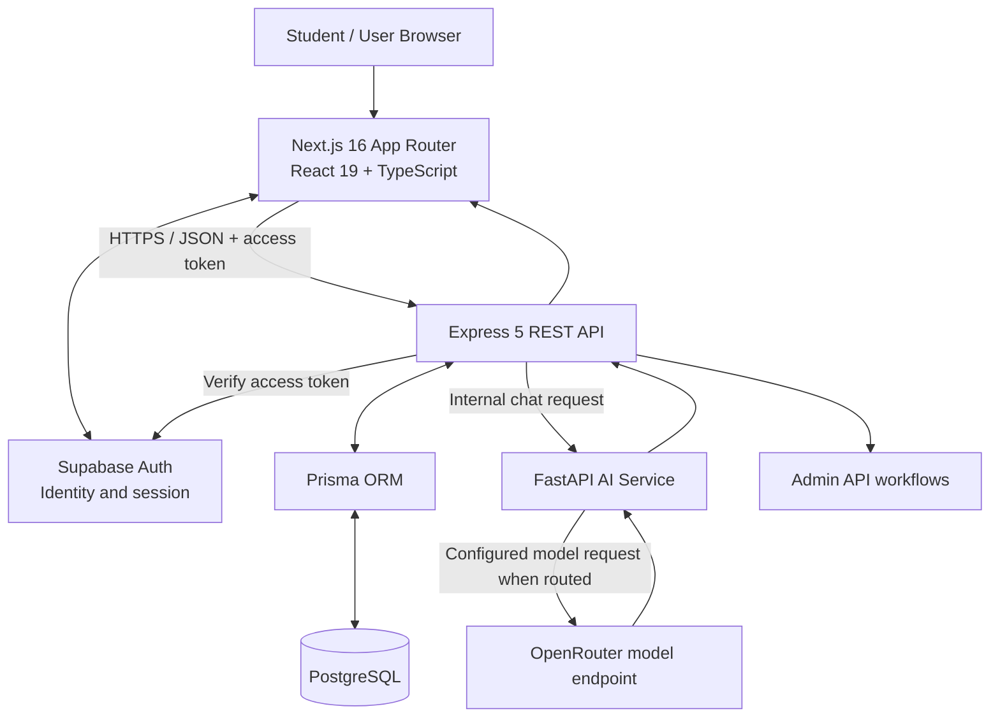

# MindCare V2

**MindCare V2 is a student-focused mental-wellness web platform that brings together AI-assisted conversation, mood check-ins, private journaling, educational resources, and counselling appointment workflows in one application.** It is designed as a supportive wellbeing tool—not a diagnostic system or a replacement for qualified mental-health or emergency care.

> **Project status:** Active development / prototype. The repository contains the core application pages and corresponding backend APIs described below. Automated checks cover backend smoke tests, mocked AI-pipeline regression tests, and frontend quality checks. These checks do not establish clinical effectiveness, production readiness, or complete database-backed end-to-end reliability.

## Product overview

Students may experience academic pressure, anxiety, loneliness, disrupted sleep, or difficulty finding appropriate support. MindCare organizes several low-friction ways to reflect, learn, and find support in one consistent interface.

The product is built around five connected journeys:

1. **Reflect:** record a mood check-in or write a private journal entry.
2. **Explore:** find curated mental-wellness information in the resource library.
3. **Talk:** start an AI-assisted conversation with risk-aware response routing.
4. **Manage:** maintain a profile and control available consent preferences.
5. **Connect:** browse counsellor profiles and available time slots, then submit or manage an appointment request.

These tools are complementary. Mood entries and journal entries remain user-scoped records; the current implementation does not automatically share journal content or attach mood history to AI prompts.

## Application architecture

MindCare uses a layered web architecture. The browser interacts with the Next.js application and the Express API. Express owns application authorization and data workflows, Prisma accesses PostgreSQL, and a separate FastAPI service handles AI chat processing.

### Component responsibilities

| Component | Responsibility |
|---|---|
| **Next.js / React frontend** | Application routes, layouts, forms, chat interface, feature screens, client-side state, and loading/error presentation. |
| **Supabase Auth** | User identity and session/token lifecycle. The frontend sends the access token when calling protected Express routes. |
| **Express API** | Authentication middleware, input validation, user ownership checks, business rules, REST response contracts, and orchestration of database and AI operations. |
| **Prisma + PostgreSQL** | Persistent application records, relational models, and transactional data operations. |
| **FastAPI AI service** | Chat request validation, risk-aware routing, response normalization, and model-provider integration. |
| **OpenRouter** | Server-side model-provider endpoint used by the AI service when a request is routed to a model. Provider credentials must remain server-side. |
| **GitHub Actions** | Automated backend smoke tests, AI regression tests, frontend type-checking, linting, and production-build checks. |

The AI service is an internal service boundary, not an authorization layer. The browser should call the Express API rather than calling FastAPI or the model provider directly.

## Website routes and user experience

The frontend includes public, authentication, and signed-in application routes.

| Area | Routes | Purpose |
|---|---|---|
| Public information | `/`, `/about`, `/privacy`, `/terms` | Introduce the platform and communicate product and policy information. |
| Authentication | `/login`, `/register`, `/forgot-password`, `/reset-password`, `/auth/callback` | Account access, registration, recovery, and authentication callback handling. |
| Overview | `/dashboard` | Main signed-in overview for accessing wellbeing features. |
| AI conversation | `/chat`, `/chat/[id]` | Start and revisit conversations. |
| Self-reflection | `/mood`, `/journal` | Record mood check-ins and maintain private journal entries. |
| Learning | `/resources`, `/app/resources` | Browse the resource library. |
| Personal account | `/profile`, `/settings` | Update supported profile fields and consent preferences. |
| Human support | `/counselling` | Browse active counsellors, inspect availability, and manage appointment requests. |

A route being present in the frontend is not, by itself, proof that every state is complete. Database configuration, user permissions, external services, and live integration behavior must be validated separately.

## Core features and end-to-end flows

### 1. Authentication and protected access

Supabase Auth manages identity and sessions. The Express API validates the supplied bearer token and derives the authenticated user identity from the verified token rather than trusting a user ID sent by the browser.

**Typical flow**

1. A user registers or signs in through the authentication interface.
2. Supabase establishes the session.
3. The frontend includes the access token on protected API requests.
4. Express verifies the token and applies route-level authorization.
5. Data operations are scoped to the authenticated user where the feature is user-specific.

The frontend's protected-route experience improves navigation, but server-side authorization remains the security boundary.

### 2. AI-assisted chat

The chat experience provides a conversational interface for general wellbeing support. The backend persists conversation and message activity and delegates response generation to the separate FastAPI service.

**Request flow**

1. The user submits a message from the chat page.
2. The frontend sends the request to `POST /api/chat` through Express.
3. Express validates the request and coordinates message persistence and AI processing.
4. FastAPI validates the chat payload and runs the risk-aware response pipeline.
5. Depending on the pipeline decision, the service can use a template response, a safety-oriented response path, or the configured language model.
6. Express returns the response and persists the relevant conversation state.
7. The UI updates with the returned message and supports revisiting conversation history.

The current regression suite checks important routing and normalization behavior using a mocked model-provider boundary. It does **not** prove that live model outputs are clinically safe, that risk detection is comprehensive, or that every provider/network failure is handled correctly.

MindCare's AI is not a therapist, diagnostic engine, or emergency service. Risk classification is an imperfect software signal, not a clinical assessment.

### 3. Conversation history

Users can create and list conversations, read individual conversations, update supported conversation metadata, pin or unpin a conversation, and delete a conversation.

Conversation APIs apply user ownership checks so a signed-in user should not be able to access another user's conversation by substituting an identifier.

### 4. Mood check-ins

The mood feature allows users to record and revisit mood entries, with optional notes.

**Typical flow:** open Mood → submit a check-in → Express validates the entry → the database stores it against the authenticated user → the interface refreshes from the API.

The API supports listing, creating, reading, updating, and deleting a user's mood entries. The current `share_mood_data` preference is stored, but mood history is **not currently added to AI prompts**. Do not describe this preference as an implemented AI-personalization feature.

### 5. Private journal

The journal provides a place for personal written reflections. The API supports list/search, detail, create, update, and delete operations. Journal entries are associated with the authenticated user, and the backend checks ownership during record access.

The API enforces a content limit of 30,000 characters. Journal content is sensitive personal information and should not be exposed in logs or included in AI prompts without a separate, explicit and well-defined consent workflow.

### 6. Mental-wellness resource library

The resource library exposes a searchable collection of curated external resources. The API supports text search, category filtering, and retrieving an individual resource. A seed script provides three starter resources from established public mental-health organizations, including WHO, NIMH, and NHS sources.

The library is intended for psychoeducation and signposting. Listing a resource does not imply that MindCare has clinically evaluated every external page or that the content is appropriate for every user.

### 7. Profile and consent preferences

The profile API supports reading and updating the signed-in user's supported profile fields. Email and role are not editable through the profile update contract. Consent preferences are stored per user, with privacy-preserving defaults.

Current preference examples include `share_mood_data` and `notifications`. These are preference records; a stored preference does not imply that every downstream behavior—such as email delivery, mood sharing, or AI personalization—has been implemented. Any future use of sensitive data should enforce the relevant consent at the point of use.

### 8. Counselling and appointments

The counselling workflow connects the user interface to counsellor profiles, availability slots, appointment requests, and administrative status management.

**User flow**

1. The user opens Counselling and requests the active counsellor list.
2. The user selects a counsellor and date.
3. The API returns eligible future availability slots for that date.
4. The user selects a slot and submits a booking request.
5. The backend claims the slot through a transactional/conditional update and creates the appointment record.
6. The user can view their own appointments and cancel an eligible booking.
7. An administrator can review appointment requests and update their status.

The slot-claim logic is designed to prevent two users from successfully claiming the same slot. This behavior still needs dedicated database-backed concurrency testing in the target environment.

Administrative endpoints are role-restricted. The repository also contains an opt-in demo-counsellor seeding change in an open draft pull request; fictional demo records must never be represented as verified practitioners or used for real clinical appointments. Real provider listings require verified professionals and genuine availability.

## Data model overview

The Prisma/PostgreSQL data layer includes records for the main application domains:

- **User and profile preferences:** application profile information and user-specific settings.
- **Conversation and message records:** conversation ownership, messages, timestamps, and associated analysis data.
- **Mood entries:** user-scoped mood scores and optional notes.
- **Journal entries:** user-scoped private written reflections.
- **Resources:** catalog entries and external resource metadata.
- **Consent preferences:** per-user records of supported consent choices.
- **Counsellors and availability slots:** provider profile information and bookable time windows.
- **Appointments:** user booking records, slot association, and workflow status.

The key data-access principle is that identity and record ownership are enforced by the backend. The browser must not be trusted to establish ownership simply by submitting a record ID or user ID.

## API surface

The following table summarizes the Express routes implemented in the current V2 codebase. Protected endpoints require valid authentication; administrative routes also require the appropriate role.

| Method | Endpoint | Responsibility |
|---|---|---|
| GET | `/health` | Backend health check. |
| GET | `/api/auth/me` | Validate the current identity and return the application user. |
| GET, POST | `/api/conversations` | List or create conversations. |
| GET, PATCH, DELETE | `/api/conversations/:conversationId` | Read, update supported metadata, or delete an owned conversation. |
| PATCH | `/api/conversations/:conversationId/pin` | Pin or unpin an owned conversation. |
| POST | `/api/chat` | Process a chat message through the backend and AI service. |
| GET, POST | `/api/moods` | List or create mood entries. |
| GET, PATCH, DELETE | `/api/moods/:moodId` | Read, update, or delete an owned mood entry. |
| GET | `/api/resources?search=&category=` | Search or filter resources. |
| GET | `/api/resources/:resourceId` | Read a resource. |
| GET, POST | `/api/journal` | Search/list or create journal entries. |
| GET, PUT, DELETE | `/api/journal/:id` | Read, update, or delete an owned journal entry. |
| GET, PUT | `/api/profile` | Read or update supported profile fields. |
| GET, POST | `/api/consents` | Read or save consent preferences. |
| GET | `/api/counsellors` | List active counsellors. |
| GET | `/api/counsellors/:id/slots?date=YYYY-MM-DD` | List eligible availability slots. |
| GET, POST | `/api/appointments` | List the user's appointments or request a booking. |
| DELETE | `/api/appointments/:appointmentId` | Cancel an owned appointment when allowed. |
| GET, POST | `/api/admin/counsellors` | Admin: list or create counsellor profiles. |
| POST | `/api/admin/counsellors/:counsellorId/slots` | Admin: create availability slots. |
| GET | `/api/admin/appointments?status=pending` | Admin: list appointment requests by status. |
| PATCH | `/api/admin/appointments/:appointmentId/status` | Admin: update an appointment's workflow status. |

The FastAPI service exposes `POST /api/v1/chat` for backend-to-service communication. The browser should not call this internal endpoint directly.

## Privacy, security, and responsible use

MindCare handles sensitive wellbeing information, so privacy and safety must be treated as core system requirements rather than optional UI features.

- **Authentication:** protected Express routes verify the Supabase-issued token.
- **Authorization:** user-specific records must be queried and mutated within the authenticated user's ownership scope.
- **Role boundaries:** administrative counselling operations require an authorized admin role.
- **CORS:** the API uses a configured frontend-origin allowlist. CORS is not a substitute for authentication or authorization.
- **Secret handling:** database credentials and model-provider keys belong in server-side configuration and must never be exposed to browser code or committed to version control.
- **Data minimization:** avoid logging chat messages, journal content, access tokens, or other sensitive payloads.
- **Consent enforcement:** preferences should be checked by each feature that uses the corresponding data; storing a consent value alone does not implement downstream behavior.
- **AI limitations:** model responses may be inaccurate, biased, or inappropriate. Risk checks reduce some risks but cannot guarantee safety.
- **Demo data:** fictional counsellors are for interface/testing demonstrations only, not real care.
- **Scope:** MindCare is a prototype and is not represented as a clinically validated medical device or a replacement for professional or emergency support.

Any deployment involving real users or sensitive health-related data requires a separate privacy, security, legal, clinical-safety, and operational review appropriate to its jurisdiction and use case.

## Verification and engineering quality

The repository's automated checks currently cover:

- Backend API smoke tests, including authentication rejection on protected routes.
- AI pipeline regression tests for request/response schemas, risk-aware routing, normalization, and handling of untrusted history roles; model-provider calls are mocked.
- Frontend TypeScript checking, linting, and production compilation/build.
- GitHub Actions execution of the above checks for configured branches and pull requests.

Passing CI is useful evidence of code-level consistency, but it is not equivalent to complete product validation. Important follow-up checks include:

1. Database-backed integration tests for all CRUD workflows and migrations.
2. Cross-user authorization tests for conversations, mood entries, journal entries, profile data, and appointments.
3. Concurrent appointment-booking tests against a real test database.
4. Live AI-provider tests under controlled conditions, including timeouts, malformed output, and service failure.
5. Latency and reliability measurement under representative workloads.
6. Accessibility, usability, and privacy reviews.
7. A carefully governed user study before making claims about wellbeing or clinical outcomes.

## Current limitations and next priorities

MindCare V2 is an evolving application. The main technical priorities are:

1. **Complete end-to-end verification:** test real authenticated flows against a dedicated development database.
2. **Expand security tests:** include cross-account access attempts, role boundaries, consent enforcement, and sensitive-data logging checks.
3. **Harden AI safety:** evaluate false positives/negatives in risk routing, adversarial inputs, model timeouts, and crisis-response quality with appropriate expert review.
4. **Measure performance:** establish baseline API latency, AI response latency, failure rates, and database query behavior before optimizing.
5. **Improve accessibility and usability:** test keyboard navigation, screen-reader support, mobile layouts, and clear error/empty states.
6. **Validate counselling operations:** use verified providers, real availability, clear appointment status semantics, and tested concurrent booking behavior.
7. **Conduct research responsibly:** evaluate usability and technical performance first; clinical benefit requires an appropriately designed study, ethics review where applicable, and measured outcomes.

## Research context

Digital mental-health tools can broaden access to information and support, but their usefulness depends on engagement, privacy, safe implementation, human-support pathways, and evidence from real-world evaluation. MindCare's architecture is a technical prototype for studying the integration of conversational AI, self-reflection tools, educational resources, and appointment workflows. Its current implementation and automated tests should be reported as engineering evidence—not as proof of therapeutic efficacy.

A publication based on this project should clearly separate (a) implemented system capabilities, (b) automated test results, (c) proposed evaluation methods, and (d) outcomes that have not yet been measured. No claim of clinical effectiveness should be made without suitable empirical evidence.

## Repository

Source code: [github.com/dhopavkarSujal/MindCare](https://github.com/dhopavkarSujal/MindCare)

MindCare V2 is being developed iteratively. Feature descriptions in this document are intended to reflect the current source tree and registered API surface; always verify the relevant code and test results before relying on a feature in a production or clinical context.
