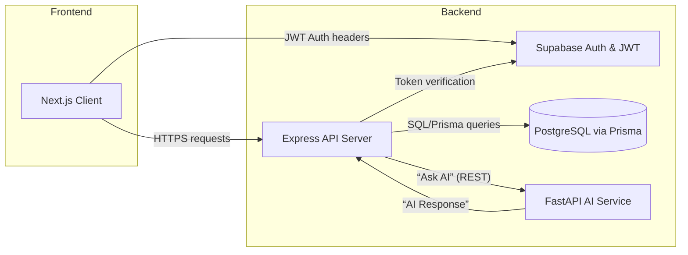
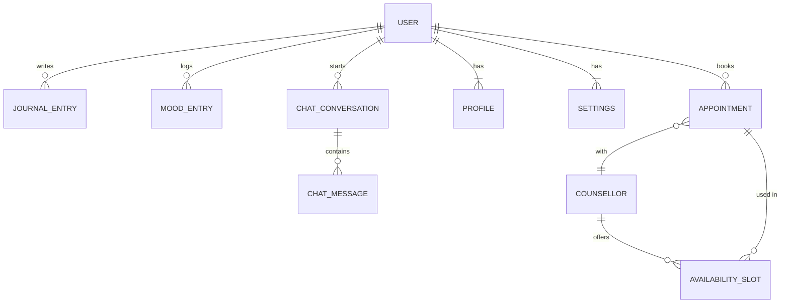

# MindCare Digital Mental Health & Psychological Support System
<p align="center">
  <strong>A digital mental-health support platform designed to make student wellbeing support more accessible, private, and easier to reach.</strong>
</p>

<p align="center">
  <a href="#features">Features</a> •
  <a href="#system-architecture">Architecture</a> •
  <a href="#technology-stack">Tech Stack</a> •
  <a href="#installation--setup">Setup</a> •
  <a href="#api-overview">API</a> •
  <a href="#future-enhancements">Roadmap</a>
</p>

## Executive Summary  
MindCare V2 is a web-based mental-health support platform designed with modern, scalable web technologies. It features a **Next.js/React** frontend, a **Node/Express** backend (with TypeScript), a **Prisma/PostgreSQL** database, and **Supabase** for user authentication. An AI‐powered chat service (via a FastAPI microservice calling language models) provides conversational support with built‐in safety checks. Key user features include **AI chat**, **mood tracking**, **resource library**, **private journaling**, **user profile and consent settings**, and **counselling appointment booking**. The system enforces user-specific access controls, follows privacy-by-design principles, and integrates consent-aware preferences. This README summarizes the system architecture and user flows.  Deployment instructions are omitted here – instead, this focuses on the architecture, data flows, and features of MindCare V2.

## Architecture and Components  
The application uses a **modern full-stack web architecture** with clear separation of frontend, backend, and data services. The frontend is built in Next.js (React + TypeScript), providing server-side rendering and a responsive UI. It communicates over HTTPS to an Express-based backend API, which implements all application logic and interfaces with the database and AI service. Prisma is used as a type-safe ORM layer to interact with PostgreSQL. User authentication is handled by Supabase Auth (magic-link login), and JWT tokens secure the API. The AI chat pipeline runs as a separate FastAPI service (calling an LLM provider) that the backend invokes for each user message.  The architecture is designed for modularity, security, and scalability:



- **Frontend (Next.js/React)**: Renders pages (Chat, Mood, Resources, Journal, Profile, Counselling) and manages UI state. It uses React Hooks for data loading and form state. The UI calls the backend REST API via fetch/axios.
- **Backend (Node/Express)**: Implements the REST API. Routes are organized by feature (e.g., `/api/chat`, `/api/mood`, etc.). It enforces CORS to allow requests only from the trusted frontend origin. Protected routes require a valid Supabase JWT. The backend uses Prisma Client (v6.x) to perform database operations.
- **Authentication (Supabase Auth)**: Supabase handles email-based login. Upon sign-in, the frontend receives a JWT which it includes in API requests. The backend validates the token and extracts the user ID for database queries.
- **Database (PostgreSQL)**: Stores user data, journal entries, mood entries, resources, counsellors, availability slots, appointments, etc. Prisma schema defines models for each entity. 
- **AI Service (FastAPI)**: A separate Python service exposes endpoints for chat. It receives a user message (and optional conversation history), computes a risk score, and either routes to a crisis response or calls an LLM (via OpenAI/OpenRouter) to generate a reply. Regression tests ensure safe behavior.

## Data Model (Highlights)  
MindCare’s Prisma schema defines key tables for its domain. User accounts are managed by Supabase, but we extend user data with these models (simplified view):

- **User** (managed by Supabase, with unique ID). 
- **JournalEntry**: `(id, userId → User, title, content, createdAt, updatedAt)`. Private entries per user.  
- **MoodEntry**: `(id, userId → User, mood (e.g. integer), notes, createdAt)`. Logs of user mood.  
- **Resource**: `(id, title, url, category, description, createdAt)`. Curated mental-health resources (seeds are provided).  
- **Profile/Settings**: Separate tables keyed by `userId` for personal info (displayName, etc.) and consent preferences (shareMood, enableNotifications).  
- **Counsellor**: `(id, name, specialty, bio, avatarUrl, timeZone, isActive, createdAt)`. Profiles for counsellors (demo seed data provided).  
- **AvailabilitySlot**: `(id, counsellorId → Counsellor, startsAt, endsAt, isAvailable, isActive)`. Future appointment slots.  
- **Appointment**: `(id, slotId → AvailabilitySlot, userId → User, status (PENDING/CONFIRMED/CANCELLED), createdAt)`. Booking records.  
- **ChatConversation**: `(id, userId → User, createdAt)`. A chat session.  
- **ChatMessage**: `(id, conversationId → ChatConversation, senderRole (USER/AI), content, riskScore, createdAt)`. Historical messages.

These models ensure one-to-many and ownership relations (each entry or booking ties back to a specific user, enforcing privacy). A simplified ER diagram:



Example SQL seeding (demonstration only) – to add test counsellors:

```sql
INSERT INTO "Counsellor"(id, name, specialty, bio, timeZone, isActive, createdAt, updatedAt)
VALUES 
 ('a1000000-0000-4000-8000-000000000001', 'Dr. Aanya Sharma (Demo)', 'Academic Stress', 'Demo profile', 'Asia/Kolkata', TRUE, NOW(), NOW()),
 ('a1000000-0000-4000-8000-000000000002', 'Dr. Rohan Mehta (Demo)', 'Mindfulness', 'Demo profile', 'Asia/Kolkata', TRUE, NOW(), NOW()),
 ('a1000000-0000-4000-8000-000000000003', 'Dr. Isha Patel (Demo)', 'Personal Growth', 'Demo profile', 'Asia/Kolkata', TRUE, NOW(), NOW())
ON CONFLICT (id) DO NOTHING;
```

Sample Prisma-style snippet to create an appointment (ensuring atomic slot claim):

```js
// In an Express handler
const slot = await prisma.availabilitySlot.findFirst({
  where: { id: slotId, isAvailable: true, isActive: true }
});
if (slot) {
  await prisma.$transaction([
    prisma.availabilitySlot.update({
      where: { id: slotId },
      data: { isAvailable: false }
    }),
    prisma.appointment.create({
      data: {
        slotId: slotId,
        userId: userId,
        status: 'PENDING'
      }
    })
  ]);
}
```

## Key Features and User Flows  
MindCare V2 integrates multiple mental-health support tools into one platform:

- **AI Chat**: A conversational interface where a user can message the system. The backend evaluates each user message with a risk-assessment (e.g. crisis detection). Low-risk queries proceed to a GPT-4–based completion, while high-risk queries trigger a crisis-support response (without the LLM) to ensure safety. Conversations persist in the database. All chat endpoints are authenticated. Example endpoints: `POST /api/chat/conversations` (start new), `POST /api/chat/conversations/{id}/messages` (user message), `GET /api/chat/conversations/{id}` (history).

- **Mood Tracking**: Users can log their daily mood on a simple scale and add notes. This data can be shared (if the user opts in) on their dashboard and used to give context in AI chats. The setting **“shareMood”** toggles whether mood entries appear on the public dashboard. Endpoints include `GET /api/mood` (list user’s entries) and `POST /api/mood` (create entry).

- **Resources Library**: A searchable, filterable catalog of mental-health resources (articles, websites, videos). Endpoints: `GET /api/resources` (list with optional query/category filters) and `GET /api/resources/{id}` (detail). Users must be authenticated to access resources. The database is seeded with example links; more can be curated via Prisma.

- **Journal**: A private diary feature for users to write reflections. Full CRUD is supported via REST endpoints (`GET /api/journal`, `POST`, `GET /api/journal/{id}`, `PUT/PATCH`, `DELETE`). Each journal entry is tied to one user, and only that user can read or modify it.

- **Profile & Settings**: Users view/update their profile (display name, etc.) and granular consent settings. For example, the **“Mood Sharing”** consent controls whether mood entries appear on the global dashboard. Another setting toggles email notifications. Endpoints: `GET /api/profile`, `PATCH /api/profile`, `GET /api/settings`, `PATCH /api/settings`.

- **Counselling & Appointments**: Users can browse listed counsellors and their available time slots, then book or cancel appointments. The list of counsellors (`GET /api/counsellors`) shows only active profiles. For a given counsellor, users query slots (`GET /api/counsellors/{id}/slots?date=YYYY-MM-DD`). To book, the frontend calls `POST /api/appointments` with slot ID. The backend ensures the slot is still available before creating an Appointment record. Users list their bookings with `GET /api/appointments` and cancel with `DELETE /api/appointments/{id}` (only future slots can be cancelled). Administrators (role=ADMIN) have separate endpoints (`GET /api/admin/appointments?status=pending` and `PATCH /api/admin/appointments/{id}/status`) to confirm or reject booking requests. 

Data persistence, user ownership checks, and atomic transactions ensure reliable flow. Example availability query: 

```sql
-- Find available slots for counsellor on a given date (IST)
SELECT * FROM "AvailabilitySlot"
WHERE "counsellorId" = 'a1000000-0000-4000-8000-000000000001'
  AND DATE(("startsAt" AT TIME ZONE 'Asia/Kolkata')) = '2026-10-27'
  AND "isAvailable" = TRUE;
```

## Privacy, Security, and Consent
MindCare V2 emphasizes privacy-by-design. Sensitive data (journal content, mood logs, chat transcripts) are stored with appropriate database access controls. All personal data access is gated by the Supabase user ID. We do **not** store plain-text passwords (Supabase handles auth). The platform avoids unnecessary data collection: e.g. counsellors’ bios are purely voluntary. 

Consent preferences (Mood Sharing, Notifications) are explicitly opt-in and stored per user. This follows ethical guidance that users control what data is shared. Authentication tokens (JWT) are stored securely (e.g. HttpOnly cookies or memory) and transmitted only over HTTPS. CORS is locked down to the deployed frontend origin. For AI chat, the system strips any personal identifiers before sending to the LLM, minimizing PHI exposure. If this were a production medical app, further HIPAA/GDPR compliance measures would be required (encrypted storage, detailed audit logs, etc.), but those are beyond this prototype’s scope.

## Verification Checklist  
To confirm the system is running correctly and the AI chat pipeline works end-to-end, follow this checklist: 
- **Environment**: Ensure `.env` vars (DB connection, Supabase keys, AI API keys) are set.  
- **Install & Build**: In the project root, run `npm ci` (or `npm install`) then `npm run dev`. Confirm the frontend and backend start without errors.  
- **Database Migrations/Seed**: Verify `npx prisma migrate status` reports up-to-date. If not, apply migrations and rerun seed scripts for resources and demo counsellors.  
- **Authentication Flow**: Open the app in a browser. Sign up/in with email link. Refresh page and verify token is preserved. Log out and check protected pages (e.g. Dashboard) are inaccessible.  
- **Core Features**:  
  - *Chat*: Start a new conversation. Send a message (non-crisis) and receive an AI response. Refresh and confirm conversation persists.  
  - *Crisis Check*: (If safe) send an extreme message (e.g. self-harm crisis keywords) and confirm the system returns a crisis-support message instead of normal AI answer.  
  - *Mood Logging*: Save a mood entry. Refresh page; the entry should still be listed. If sharing is enabled, the mood should appear on the Dashboard.  
  - *Resources*: Visit the Resources page and confirm seeded links are displayed, searchable, and filterable by category.  
  - *Journal*: Create a journal entry (title + content). Refresh and edit/delete it; changes should persist correctly. Search in journal list for it.  
  - *Profile/Settings*: Change profile name and toggle consents. Refresh and ensure values are retained. Try with another test account to confirm isolation (they cannot see each other’s settings).  
  - *Counselling*: Log in as an admin account (set via Supabase). Use the Admin interface to add a counsellor profile and availability slot in the future (or use the provided SQL seeds). Switch to a normal user, browse `app/counselling`, book a slot. Attempt to double-book the same slot with a second user; the second should fail (slot no longer visible or “already booked”). Finally, as admin review the pending appointment request and confirm it; verify the appointment status updates and is reflected in the user’s list.  
- **AI Pipeline**: Monitor network calls during chat. Check backend logs to ensure messages are sent to FastAPI and responses received. Verify that only one request per user message is made. All test flows should complete without errors.  

<hr>  

# MindCare V2 Research Paper  

## Executive Summary  
MindCare V2 is a full-stack digital mental-health platform combining web-based user interfaces with an AI-driven conversational agent. It integrates features such as AI chat (with safety filtering), mood tracking, educational resources, private journaling, user consent management, and tele-counselling. The system architecture uses Next.js for the frontend, a Node.js/Express backend with Prisma/PostgreSQL, and Supabase for authentication. A Python FastAPI service handles the generative AI pipeline. This paper situates MindCare V2 within the broader context of digital mental health interventions, describing its design decisions, implemented features, and underlying data models. We analyze these choices against evidence-based guidelines and research findings. Furthermore, we outline an evaluation plan for functionality, safety, and user experience, and discuss limitations and ethical considerations (e.g. privacy, bias, and efficacy). Finally, we suggest directions for future improvement and research-driven enhancements.

## Introduction and Background  
Digital mental health interventions are rapidly expanding, offering scalable tools to address the global treatment gap. According to the American Psychiatric Association (APA), roughly half of those with mental illness lack access to care, while a majority own smartphones. This suggests a potential for mobile/web platforms to augment traditional care. The COVID-19 pandemic has further accelerated adoption of telehealth and digital therapeutics. Scholarly reviews note that the field now extends beyond simple teletherapy to include smartphone apps, virtual reality, and AI chatbots. However, “industry setbacks and methodological critiques have highlighted gaps in evidence” – many apps exist, but rigorous validation is often lacking. For example, Torous *et al.* (2025) emphasize the need for controlled, real-world studies of digital tools. Engagement is another challenge; unguided apps typically have low effectiveness unless combined with human support.  

Key best practices emerge from this literature: applications should embed evidence-based therapeutic techniques, respect privacy and consent, and integrate professional support or peer navigation. The Global Mental Health Action Network also highlights that unsupervised digital tools “do not work better than existing clinical alternatives” and that *support* (e.g. digital navigators) is “fundamental to effectiveness”. Ethical guidelines stress user autonomy, clarity about data use, and avoiding harm. For instance, the APA’s mHealth guidelines underscore transparency, encryption of health data, and patient control over data sharing (e.g. HIPAA/OCR considerations).  

MindCare V2 is built with these principles in mind. It provides multiple complementary tools – from AI-driven chat to human-mediated appointments – aiming to blend automated support with options for human intervention. This work documents the system’s design and situates it against research evidence.

## System Architecture and Design  
MindCare’s architecture reflects current web development best practices for scalability, security, and developer productivity. The **frontend** is Next.js, a React framework supporting server-side rendering (SSR) and static optimization. This choice enables fast page loads and SEO-friendly routes for public pages (e.g. the login and dashboard). Next.js also simplifies building React components for each feature page.

The **backend** is an Express server in Node.js with TypeScript. Express handles REST API routes under `/api/...`. The API is stateless except for JWT-based auth: a Supabase-issued token identifies the user per request. Middleware enforces authentication on protected routes and checks roles (admin vs. regular user) as needed. CORS is configured to allow only the frontend’s origin, mitigating cross-site attacks.

Data management uses **Prisma** (v6.19) as an ORM over PostgreSQL. The Prisma schema defines models matching domain entities (see Data Model section). Prisma’s generated client provides type-safe queries in the backend code, reducing runtime errors. The database runs on Supabase or a similar Postgres instance, giving flexibility and managed hosting.

Authentication relies on **Supabase Auth**, which integrates easily with React via its SDK. Users log in with email links, eliminating passwords. Upon login, Supabase returns a JWT; this token is sent by the client on each request. The Express server verifies it and obtains the `userId` (a UUID) to scope queries. This decouples authentication logic from our code and leverages Supabase’s hardened auth infrastructure.

A critical component is the **AI pipeline**. MindCare uses a separate FastAPI (Python) microservice to interface with large language models (LLMs). The Express backend does not call OpenAI directly; instead it sends requests to this local service (e.g. `POST http://localhost:8000/ai/chat`). FastAPI handles risk assessment (e.g. scanning for crisis language) and chooses a response strategy. For high-risk input, it returns a pre-set crisis response (bypassing LLM) to ensure no dangerous output. Otherwise, it sends the sanitized query to OpenAI’s API and returns the reply. This design keeps the AI logic isolated and allows independent testing and iteration. It also aligns with **Torous et al.**’s observation that “large language models can positively impact mental health care if deployed correctly” – here, “correctly” means adding safety layers.

Key design decisions and rationale:
- **TypeScript/Strong Typing**: The entire codebase (frontend and backend) uses TypeScript for better maintainability. Prisma also provides type safety for DB queries.
- **CI/CD and Testing**: Each pull request triggers tests: backend smoke tests (health endpoint, auth checks, etc.), frontend lint/type-check, and AI-pipeline regression tests (via GitHub Actions). Passing tests give confidence in core functionality.
- **Separation of Concerns**: By splitting concerns (auth, AI, database), we follow a “microservices as needed” approach without overcomplicating initial scope. Communication is via well-defined APIs.
- **Data Privacy**: We limit stored data. For AI chat, only user messages and generic responses are stored (no personal metadata). We do not store IP addresses or use tracking cookies. Supabase stores PII (emails) securely under their policy; our backend only has user IDs.

### Architecture Diagram

The following diagram illustrates the high-level deployment architecture:

```mermaid
graph TB
    A[User Browser] -- HTTPS/JSON --> B[Next.js Frontend]
    B -- Auth/JWT --> C[Supabase Auth]
    B -- API calls --> D[Express API Server]
    D -- Verify token --> C
    D -- Query/Mutate --> E[(PostgreSQL via Prisma)]
    D -- Ask AI --> F[FastAPI AI Service]
    F -- Fetch LLM --> G[LLM Provider (OpenAI/OpenRouter)]
    G -- Reply --> F --> D --> B --> A
```

## Implemented Features and Flows  
MindCare V2 implements a suite of features aligned with common therapeutic and self-care modalities. Below we describe each major feature, its purpose, and implementation highlights, followed by a summary of the REST API design (see Table 1).

**1. AI Chat with Safety Checks:** Allows users to converse with an AI agent that provides empathetic responses. Each user message is first checked for risk (keywords indicating self-harm or violence). For *high-risk* content, the AI service returns a predefined crisis-support response (e.g. a resource link or a safe goodbye) instead of using the LLM. For *low/medium risk*, the message is passed to an LLM (such as GPT-4) for a response. The chat UI displays the conversation, which is persisted on the server per user. Key aspects:
   - **Rate-limiting:** The backend may throttle requests to the AI to prevent abuse or runaway costs.
   - **Data Sanitization:** PII (names, identifying info) is stripped from prompts before sending to the LLM to preserve privacy.
   - **Token-based Auth:** Chat endpoints (`/api/chat/...`) require a valid JWT. 
   - This aligns with evidence that conversational AI can augment care if framed correctly. However, we remain cautious (per Torous *et al.*) that AI outputs must be validated and human oversight considered in future.  

**2. Mood Tracking & Dashboard:** Users can log daily moods (e.g. "Happy," "Anxious," etc.) with optional notes. This data is visualized on a personal dashboard. There is also an opt-in “Mood Sharing” feature: if enabled, a user’s entries appear anonymously in a community dashboard for aggregated viewing (e.g. “Today’s average mood among users is ‘calm’”). This respects user consent as recommended by digital health best practices. API endpoints: 
   - `GET /api/mood` – list current user’s mood logs.  
   - `POST /api/mood` – submit a new mood.  
  The UI supports refreshing and editing entries. Data persists in the `MoodEntry` table with `userId` linking. If sharing is off, another user querying the dashboard cannot see those entries.  

**3. Resource Library:** A searchable list of mental-health resources (articles, websites, videos). Used for psychoeducation. The system seeds a few starter resources (see Data Model). Users may filter by category (e.g. “Anxiety,” “Meditation”) and search by text. Endpoints:
   - `GET /api/resources` (authenticated) – supports query params `?search=...` and `?category=...`.  
   - `GET /api/resources/{id}` – details (title, description, URL).  
  This mirrors APA guidance to vet app content – we provide curated links rather than random apps.

**4. Journal (Private Diary):** A secure space for users to write reflections. All operations are user-specific:
   - `GET /api/journal` – list user’s entries (title + date).  
   - `POST /api/journal` – create entry (with `title`, `content`).  
   - `GET /api/journal/{id}`, `PUT/PATCH /api/journal/{id}`, `DELETE /api/journal/{id}`.  
  Each entry row includes `userId` so the backend only returns entries belonging to the requester. The UI allows search by title. This feature leverages known therapeutic benefits of expressive writing. In research, guided journaling has shown moderate effects on well-being when combined with other therapies; MindCare offers it as a self-help tool.

**5. Profile and Settings:**  
   - **Profile:** Users have a profile page (`/app/profile`) showing their email (non-editable), display name, and other personal info. They can update their name or other demographics (if implemented).  
   - **Settings/Consent:** At `/app/settings`, users see toggle controls for consents like “Share my mood entries on the community board” or “Receive email reminders.” These map to the `Settings` model. Toggling any setting calls `PATCH /api/settings`. The backend updates the user’s record accordingly. This implements privacy principles: users explicitly grant permissions and can revoke at any time, as recommended for ethical digital interventions.

**6. Counselling & Appointments:** Enables browsing and booking with licensed counsellors. The flow is:
   - Admin users can manage counsellors (`/api/admin/counsellors`) – e.g. create profiles and availability slots. Non-admins see only active counsellors.  
   - Students (regular users) view the counselling page, which lists available counsellors and a date picker. After picking a date, `/api/counsellors/{id}/slots?date=YYYY-MM-DD` returns that counsellor’s open slots.  
   - Booking: User selects a slot and calls `POST /api/appointments { slotId }`. The backend checks slot availability and then creates an `Appointment` with status `"PENDING"`, and marks the slot as no longer available (atomic transaction).  
   - Cancel: `DELETE /api/appointments/{id}` for future appointments. The slot is re-opened (`isAvailable = true`).  
   - Admin review: `GET /api/admin/appointments?status=pending` lists all pending requests. Admin can `PATCH /api/admin/appointments/{id}/status { "CONFIRMED" }`. When confirmed, the appointment’s status updates to `"CONFIRMED"`.  

This workflow adopts an **atomic-slot-claim** pattern to prevent double-booking. If two users try to book the same slot concurrently, one will succeed in updating `isAvailable`; the other will receive an error (the slot query will not return it). This fulfills Torous *et al.*’s emphasis on implementation science and reliable delivery models. 

**Table 1: Selected API Endpoints** (authenticated, JSON).

| Endpoint                              | Method | Description                                   |
|---------------------------------------|--------|-----------------------------------------------|
| `POST /api/auth/login`                | POST   | Authenticate (via Supabase magic link)        |
| `GET /api/chat/conversations`         | GET    | List user’s conversations                     |
| `POST /api/chat/conversations`        | POST   | Create new conversation                       |
| `POST /api/chat/conversations/{id}/messages` | POST | Send user message; returns AI reply          |
| `GET /api/mood`                       | GET    | List user’s mood entries                      |
| `POST /api/mood`                      | POST   | Create mood entry                             |
| `GET /api/resources`                  | GET    | Search/list resources (filters: search, category) |
| `GET /api/resources/{id}`             | GET    | Get resource details                          |
| `GET /api/journal`                    | GET    | List journal entries                          |
| `POST /api/journal`                   | POST   | Create journal entry                          |
| `GET /api/journal/{id}`               | GET    | View entry (must belong to user)              |
| `PUT /api/journal/{id}`               | PUT    | Update entry                                  |
| `DELETE /api/journal/{id}`            | DELETE | Delete entry                                  |
| `GET /api/profile`                    | GET    | Get user profile                              |
| `PATCH /api/profile`                  | PATCH  | Update user profile (displayName, etc.)       |
| `GET /api/settings`                   | GET    | Get user consent settings                     |
| `PATCH /api/settings`                 | PATCH  | Update consent settings                       |
| `GET /api/counsellors`                | GET    | List active counsellors (public)              |
| `GET /api/counsellors/{id}/slots?date=` | GET  | Availability of counsellor on given date      |
| `POST /api/appointments`              | POST   | Book a slot (requires `{slotId}`)             |
| `GET /api/appointments`               | GET    | List user’s appointments                      |
| `DELETE /api/appointments/{id}`       | DELETE | Cancel (future) appointment                   |
| `GET /api/admin/appointments?status=` | GET    | List pending bookings (admin only)            |
| `PATCH /api/admin/appointments/{id}/status` | PATCH | Confirm/reject an appointment (admin)      |

## Data Models and Privacy Considerations  
MindCare’s data model reflects a user-centric design. Each table that stores personal or sensitive information is keyed by the user’s unique ID (from Supabase). For example, `JournalEntry` and `MoodEntry` have a `userId` foreign key; query logic ensures a user can only access their own rows. This enforces privacy and follows the principle of least privilege. We do not store any additional personally identifying information (PII) beyond what Supabase maintains (email, user ID). 

**Data Encryption**: All data in transit is over HTTPS, and the Postgres database is expected to use TLS. In this prototype, we have not implemented field-level encryption, but any deployment handling real PHI would need at-rest encryption and strict access logging. 

**Consent & Ethics**: The platform includes features to support ethical use:
- **Informed Consent**: On signup, users agree to terms of use (not shown here) and the app informs them about data usage. In-app consent toggles (e.g. mood sharing) let users control data visibility.
- **Minimal Data Collection**: Only data users explicitly provide is stored (no tracking of clicks or location). 
- **Risk Management**: As noted, any sign of acute risk in chat triggers a safe response; user queries are never left to the LLM alone when flagged.
- **Professional Disclaimer**: The UI explicitly states that MindCare is not a substitute for professional help. This is crucial to avoid misunderstandings and aligns with healthcare ethics.

## Evaluation Plan  
To assess MindCare V2, we propose a phased evaluation focusing on functionality, safety, and user experience:

1. **Functional Testing (Smoke Tests):** Automated tests (already in CI) cover basic API functions (e.g. auth rejection, CRUD operations). We will extend these with integration tests simulating user flows (e.g. booking an appointment end-to-end).  

2. **AI Safety/Regression Tests:** As in PR #9, we maintain a suite of tests for the AI pipeline. These use a mocked OpenAI interface and include scenarios of disallowed content. We will continue to expand test cases (e.g. adversarial prompts) to ensure no hazardous outputs slip through (inspired by digital health safety guidelines).  

3. **Performance/LATENCY**: The chat latency is a key metric. We will profile response times for different message lengths and model providers (e.g. GPT-4 vs a faster model). We plan to set alert thresholds if average response > 2s to keep UX smooth.  

4. **User Testing (Pilot Study):** Subject to IRB approval, deploy MindCare to a small group for usability testing. Gather feedback on interface clarity, perceived helpfulness, and any issues encountered. We will use surveys (e.g. SUS, engagement metrics) and logs (anonymized) to measure real usage patterns. This aligns with recommendations for real-world studies.  

5. **Security Audit:** Perform a code review to check for vulnerabilities (OWASP Top 10), ensure JWT tokens cannot be forged, and that CORS headers are correct. Test common attacks (SQL injection mitigated by Prisma, XSS on inputs, etc.).  

6. **UX Metrics:** Track bounce/retention in future versions. For chat, measure how often users feel satisfied vs needing more human help (via optional feedback button). 

7. **Benchmarking:** Compare MindCare’s features to existing mental health apps (via literature or survey) to evaluate coverage. For example, how MindCare’s journaling compares to apps like “Daylio” or “Moodpath” in terms of data retention and user control (though direct user testing would be needed).

## Comparison to Research and Best Practices  
Table 2 maps MindCare V2 features to research findings and potential improvements:

| **Feature**              | **Research/Guidelines**                                                   | **MindCare Approach**                                      | **Notes/Improvements**                    |
|--------------------------|---------------------------------------------------------------------------|------------------------------------------------------------|-------------------------------------------|
| AI Chat (LLM)           | Large language models hold promise if safe; risk of hallucination. Single-turn AI lacks clinical oversight. | Tiered safety: high-risk -> fixed crisis answer, else LLM.  Stored history only user-specific. | Include a human-in-the-loop option for flagged cases; add RLHF tuned for empathy. User feedback loop. |
| Mood Tracking           | Routine mood logging can improve self-awareness. Sharing may aid social support. | User logs mood daily. “ShareMood” opt-in for community aggregate. | Could integrate just-in-time interventions (send alerts if negative trend) as JITAI recommendations. |
| Resources Library       | Informational apps can empower but need credible sources. | Curated list of vetted resources, searchable. Users can filter. | Expand with metadata (tags, author), allow clinician curation. Validate link reliability periodically. |
| Journaling              | Expressive writing aids mood management in research, especially when guided. | Secure private journal (CRUD). Saved locally to user. | Offer prompts or sentiment analysis tools. Potentially connect to therapist if needed. |
| Profile & Consent       | User control of data is essential; lack of privacy trust undermines use. | Users explicitly toggle sharing consents; data uses explained. | Monitor consent logs; incorporate GDPR features (data export/delete). |
| Counselling Booking     | Teletherapy is effective; scheduling infrastructure needed for providers. | Browse counsellors, see slots, book/cancel, admin confirms. Atomic booking prevents double-book. | Integrate video-call scheduling and reminders. Evaluate provider throughput and slot utilization. |
| AI Safety Tests         | Regular regression tests help catch issues early. | Implemented pipeline tests (mock AI) in CI (PR #9) for crisis vs normal messages. | Continuously update tests as LLM prompts evolve; consider third-party audits of the AI component. |

*Table 2. Mapping of MindCare V2 features against digital mental health research and best practices.*  

## Limitations and Ethical Considerations  
- **Clinical Efficacy**: MindCare V2 is not a clinical tool. There is no evidence it improves clinical outcomes beyond self-help. The chat is an experimental LLM, not a licensed therapist. This follows the caution that unguided digital tools alone “offer no – or only modest – improvement”. Any deployment should emphasize it as a supplement, not a replacement for therapy.  
- **Privacy**: Currently, the system relies on Supabase for security. In a real healthcare setting, one must ensure HIPAA or GDPR compliance with Business Associate Agreements, encrypted backups, audit trails, etc. Our prototype does not encrypt the DB or check for vulnerabilities (beyond basic HTTPS).  
- **Bias and Accessibility**: The AI model may reflect societal biases (e.g. cultural, gender biases) present in its training data. We have not yet tested it with diverse user groups. Similarly, the UI is only in English and lacks features for low literacy or visual impairments. Future iterations should address these (e.g. multilingual support, WCAG compliance, accessible design). This is in line with calls to “ensure innovations work for all”.  
- **Data Accuracy**: All logged data (mood scores, journal entries) is self-reported and subjective. Analysis from such data should be taken cautiously (for example, using mood trends for AI context is experimental).  
- **Ethical Use of AI**: We must avoid giving medical or legal advice. Therefore, AI responses include disclaimers (“I am not a professional…”) and guidelines to seek real help. The system logs and monitors for potential abusive or erroneous AI behavior.

## Future Work  
Areas for further development:

- **Enhanced AI Personalization**: Incorporate reinforcement learning or custom fine-tuning to make AI responses more tailored (within safe bounds). Monitor for drift.  
- **Integration with Therapists**: Build features for patients to share transcripts with their therapist (with permission), or for therapists to push exercises via the platform.  
- **Digital Navigator Support**: Following evidence on digital navigators, add an option for human coaches or chatbots that can triage or encourage user engagement.  
- **Longitudinal Studies**: Partner with researchers to run a pilot clinical study measuring MindCare’s impact on well-being (PHQ-9, GAD-7 scores, etc.) vs. a control. This aligns with recommendations for rigorous trials.  
- **Mobile App**: Develop an offline-capable mobile client to broaden access (the architecture’s backend API would remain the same).  
- **Feature Expansion**: Based on user feedback, add modules (e.g. guided meditations, peer support forums, resource bookmarking). Ensure each new feature is grounded in evidence or theory (e.g. CBT techniques for self-help modules).

## Conclusion  
MindCare V2 exemplifies a modern, integrated digital mental health platform. Its layered architecture – combining a responsive frontend, a robust backend, and an AI service with safety rails – is aligned with current technology trends. Implemented features target core supportive interventions (chat, journaling, self-tracking, and professional access). By comparing these to the literature, we see MindCare follows best practices like ensuring privacy, requiring user consent, and providing human support channels. However, like most early-stage digital therapies, MindCare remains unvalidated clinically; it is a prototype highlighting technical possibilities. Future work must emphasize user studies, broader accessibility, and ongoing safety monitoring. With responsible development, platforms like MindCare could contribute to more accessible mental health care worldwide.

